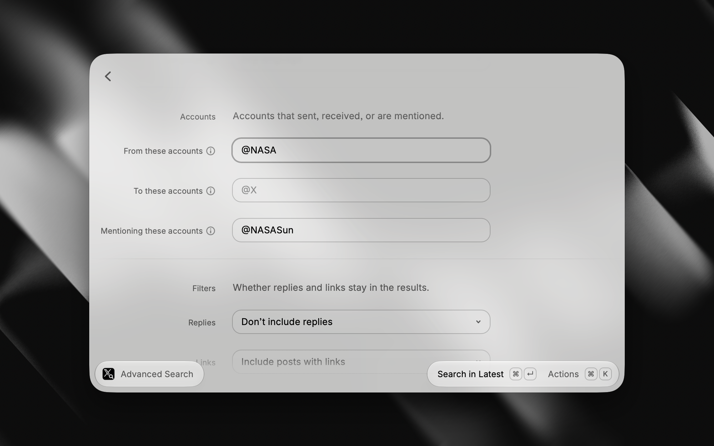
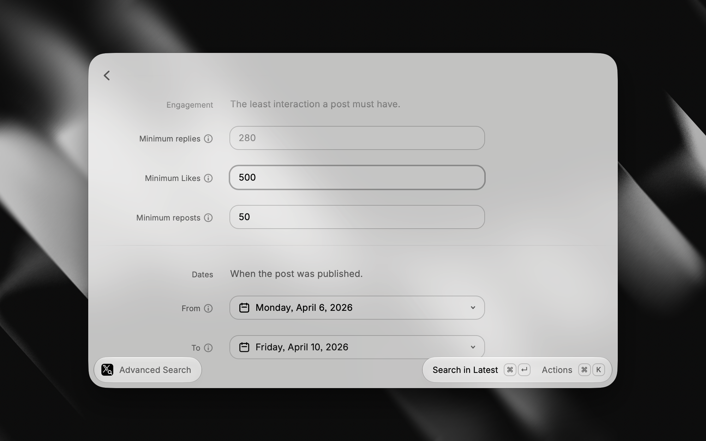
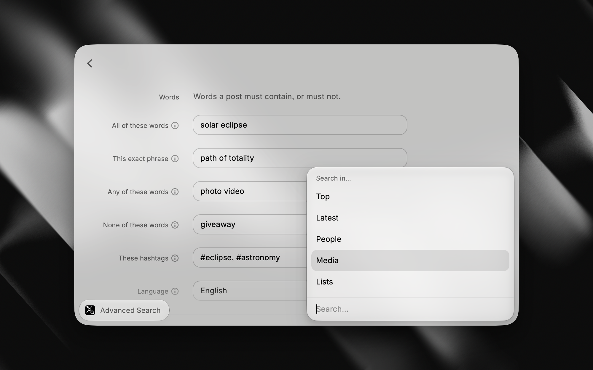
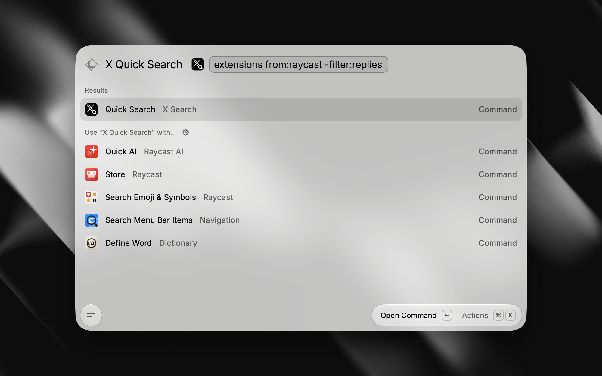

# X Search

Development repository for the X Search Raycast extension.

Advanced Search fills in the same fields as X's advanced search. Quick Search opens a search query as typed. Both open the search on x.com. Results stay on x.com.

## Screenshots

Advanced Search with the Words fields filled in and English as the language.


Accounts and Filters. The search keeps posts from @NASA that mention @NASASun and leaves out replies.



Engagement and Dates. The search keeps posts with at least 500 Likes and 50 reposts, published from 6 to 10 April 2026.



Search in opens the advanced search in any results tab.



Quick Search takes a search query typed as in X's search box.



## Two repositories

- **This development repository** holds the extension, its tests, and the contributor docs. Development happens here.
- **The Store repository**, [raycast/extensions](https://github.com/raycast/extensions), holds the copy the Raycast Store ships, in `extensions/x-search`. It has no tests.

Please open issues and pull requests here. A repository sync keeps the extension code the same in both. [ADR 0001](docs/adr/0001-development-and-store-repositories.md) explains why there are two repositories.

The Store package is [extension/](extension/), and its [README](extension/README.md) is what extension users read in the Store.

## Develop

```sh
npm install
npm run dev
npm run quality-check
```

Read [CONTRIBUTING.md](CONTRIBUTING.md) before changing the extension. [docs/architecture.md](docs/architecture.md) maps the code, and [GLOSSARY.md](GLOSSARY.md) defines the terms used here.
