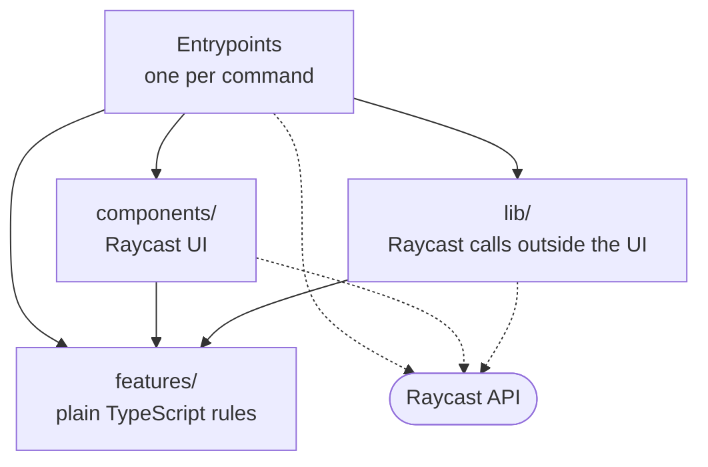

# Architecture

X Search writes a search query, builds the search link, and opens it on x.com. It does not fetch posts or sign in to X.

## Repository layout

- `extension/` is the package that ships to the Raycast Store. Raycast's publish tooling copies the whole folder, so only shipped files go there.
- `tests/`, `docs/`, and the root config files are for development only.
- `design/` holds the icon source. It does not ship.

## Source layers

`extension/src/` has four layers. An arrow means "may import".

- **Entrypoints** (`src/*.tsx`) each wire one command and own its failure feedback.
- **`components/`** renders the parts of a command's UI.
- **`lib/`** wraps the Raycast calls that are not UI, such as preferences and opening links.
- **`features/`** decides what each search contains. The tests cover it.

`extension/eslint.config.js` enforces these arrows. Change its `dependencies` map and this diagram together.
